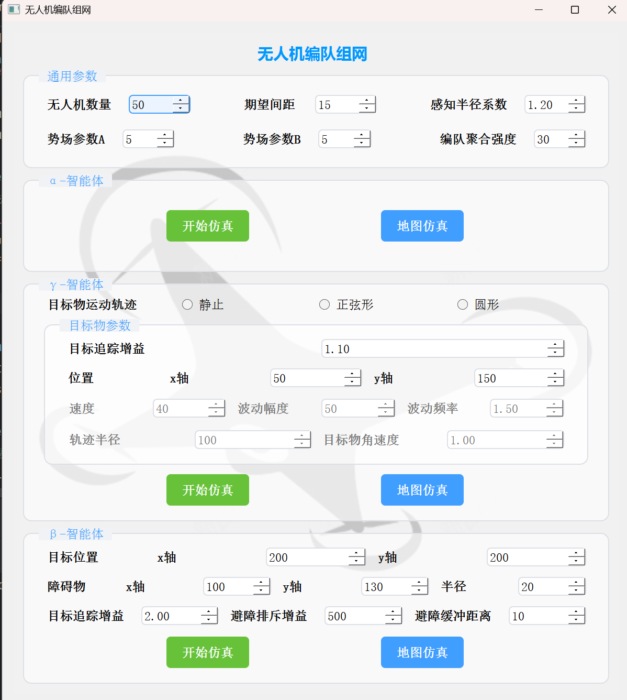
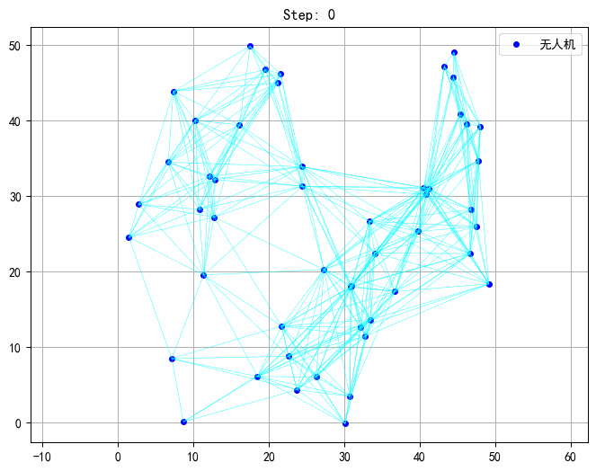
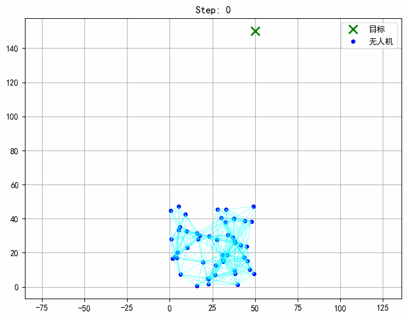
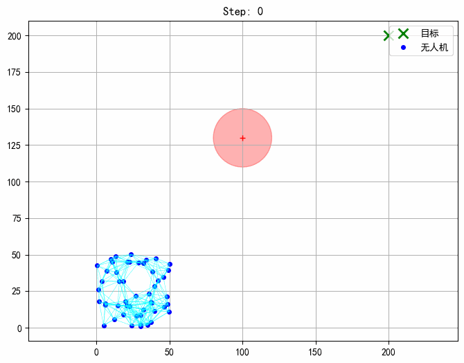
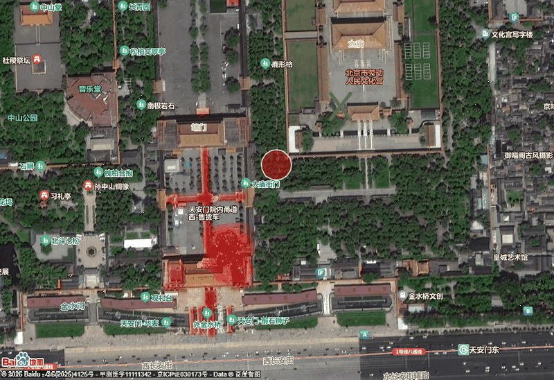
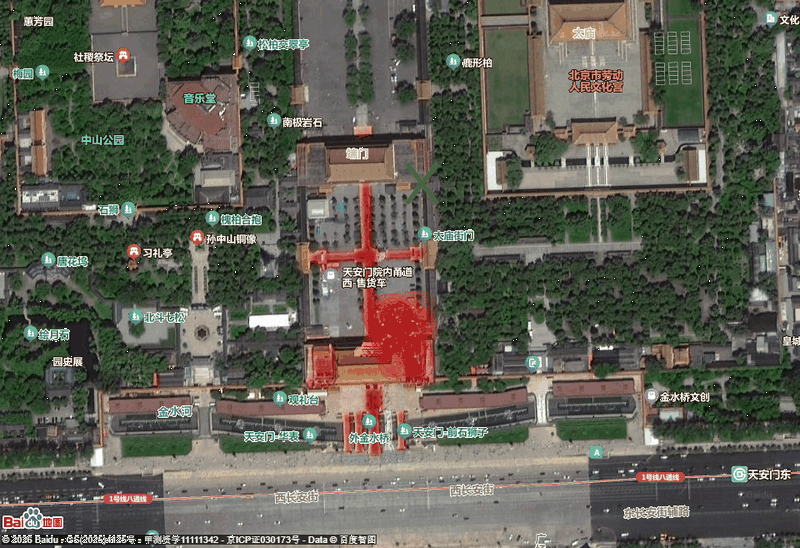

# 无人机编队系统的设计与开发

基于 **Olfati-Saber 群集控制算法**（α / γ / β 三类智能体）的二维无人机编队仿真系统。  
Python + PyQt5 桌面端，支持 **Matplotlib 数学空间仿真**与**百度地图实景映射**两种可视化模式。



---

## 一、项目来源

控制律**不是自创的**，三类交互项均实现自 Olfati-Saber 的这篇论文：

> **R. Olfati-Saber, "Flocking for Multi-Agent Dynamic Systems: Algorithms and Theory,"**  
> *IEEE Transactions on Automatic Control*, vol. 51, no. 3, pp. 401–420, Mar. 2006.  
> DOI: [10.1109/TAC.2005.864190](https://doi.org/10.1109/TAC.2005.864190)（原文随仓库附带：`docs/Olfati-Saber.pdf`）

| 本项目实现                  | 论文出处                            | 内容                                                           |
| ---------------------- | ------------------------------- | ------------------------------------------------------------ |
| **α 交互项**：编队与防撞        | §III，式 (22)(23)、**Algorithm 1** | 梯度项（管间距）+ 一致性项（管速度）                                          |
| α + γ 叠加               | §III，式 (24)、**Algorithm 2**     | `u_i = u_i^α + u_i^γ`                                        |
| **γ 交互项**：目标追踪         | §II-E、§III                      | 位置反馈 + 速度前馈（导航反馈）                                            |
| **β 交互项**：障碍规避         | §VII，式 (58)(59)、**Algorithm 3** | 多物种势函数 + 障碍排斥                                                |
| β 虚拟点的位置与速度            | §VII-D，**Lemma 4(ii)**          | `q̂_ik = μq_i + (1−μ)y_k`，`p̂_ik = μPp_i`，`P = I − a_k a_kᵀ` |
| σ-范数 / Bump 函数 / 势函数 φ | §II、§III                        | 平滑距离度量、邻接权重、吸引—排斥曲线                                          |

---

## 二、各模块功能与演示

程序按「模型 — 视图 — 控制」三层拆成四个文件。

### 2.1 `simulation.py` —— 物理引擎与控制算法（模型层）

一次算出全场所有无人机的控制量（`calculate_u_all()`），三项按场景叠加，再用欧拉法按固定步长推进（`_physics_step()`）。三种模式的差别只是开哪几项：α 用 `u_i^α`，γ 用 `u_i^α + u_i^γ`，β 用 `u_i^α + u_i^γ + u_i^β`。

| 交互项   | 作用                                          | 论文         |
| ----- | ------------------------------------------- | ---------- |
| **α** | 邻居太近互推、太远互拉，平衡位置即期望间距；再对速度差做一致性，全场速度收敛到同一值  | 式 (22)(23) |
| **γ** | 位置反馈 + 速度前馈，只用到目标的当前位置与当前速度，不需要预知目标轨迹       | 式 (24)     |
| **β** | 障碍物当虚拟邻居产生排斥力，另加只作用于法向速度的阻尼项，使其沿障碍边缘绕行而不是弹开 | 式 (58)(59) |

输出分两路：`run_matplotlib()` 驱动图窗动画，`update_map_step()` 推送到地图模式。

**α · 编队一致性** —— 只开 α 项、无目标牵引时的自组织过程：个体被斥力推出感知范围后彼此失联，机群分裂成多个子群（论文称之为 **regular fragmentation**），故 α 模式只跑固定步数、不设收敛判据。



**γ · 目标追踪** —— 绿色虚线为目标轨迹，黑色实线为机群重心轨迹，两者基本贴合。



**β · 追踪 + 障碍规避** —— 红色圆为障碍物，个体自主形变、沿边缘绕飞，通过后由 α 项把编队拉回。



### 2.2 `main_gui.py` —— 界面与交互（控制层）

程序入口：解析 `.ui`、绑定信号槽、收集界面参数、按所选模式实例化仿真，并用 `QTimer` 驱动主循环；地图模式下另建弹出窗口与悬浮控制板（开始 / 停止 / 退出，以及拖动即时生效的目标、障碍物位置滑杆）。

界面用 Qt Designer 设计，按三类智能体分区，每个分区都有「开始仿真」（Matplotlib）与「地图仿真」（百度地图）两个入口：

- **通用参数**：无人机数量 N、期望间距 D、感知半径系数 K、势场参数 A / B、编队聚合强度 c1^α
- **α-智能体**：启动编队一致性仿真
- **γ-智能体**：目标轨迹（静止 / 正弦形 / 圆形）+ 追踪增益、位置、速度、幅值频率、轨迹半径、角速度
- **β-智能体**：目标与障碍物位置、障碍半径、追踪增益、排斥增益、缓冲距离

### 2.3 `map_widget.py` + `baidu_map.html` —— 地图可视化（视图层）

`map_widget.py` 继承 `QWebEngineView`，把数学坐标换算成经纬度（基准点 116.404°E / 39.915°N，比例 `1e-5`），连同邻接表、障碍物、目标、机群中心序列化成 JSON 注入网页；`baidu_map.html` 引入百度地图 JS API，由 `updateMap()` 把数据重绘成无人机点、邻接连线、目标标记、障碍物圆，并把视野居中到机群重心。

**地图模式演示**（与上面的 Matplotlib 仿真同一套控制律，只是把数学坐标搬到真实地图上）：

**β · 追踪 + 障碍规避**——红色圆为障碍物，机群沿其边缘绕飞：



**γ · 目标追踪**：



---

## 三、各文件说明

```
.
├── README.md                     # 本说明文档
├── requirements.txt              # 依赖清单（pip install -r requirements.txt）
├── .gitignore                    # 忽略 __pycache__ / .idea / .workbuddy 等
│
├── main_gui.py                   # 程序入口：界面与交互（控制层）
├── simulation.py                 # 物理引擎与群集控制算法（模型层）
├── map_widget.py                 # 地图渲染组件（视图层）
├── drone_formation.ui            # Qt Designer 界面定义
├── baidu_map.html                # 百度地图前端页面（内含地图 AK，需换成自己的）
│
├── assets/                       # 【程序运行时素材】被代码加载，勿删
│   ├── logo.png                  #   窗口图标
│   └── drone_bg_transparent.png  #   界面背景底图
│
└── docs/                         # 【文档与演示】只给读者看，程序不加载
    ├── Olfati-Saber.pdf          #   算法原始论文
    └── images/                   #   README 配图与演示 GIF
        ├── ui_main_window.png    #     主界面截图
        ├── alpha_simulation.gif  #     α 模式（规则碎裂）
        ├── gamma_simulation.gif  #     γ 目标追踪
        ├── beta_simulation.gif   #     β 追踪 + 避障
        ├── map_mode_beta.gif     #     地图模式：β
        ├── map_mode_gamma.gif    #     地图模式：γ
        └── drone_simulation.gif  #     α 早期版本（保留备查，README 未引用）
```

---

## 四、环境与运行

```bash
# 1. 安装依赖
pip install -r requirements.txt

# 2. 启动（在项目根目录执行；程序内部按文件位置定位资源，换工作目录也能跑）
python main_gui.py
```

- Python 3.8+（本机在 3.13 / 3.14 上验证），依赖清单见 `requirements.txt`
- **地图模式需自备百度地图 AK**：把 `baidu_map.html` 中的 `ak=` 换成自己申请的密钥（仓库内的 AK 请勿直接使用），并保持联网
- 地图模式依赖 `PyQtWebEngine`；只跑 Matplotlib 仿真也建议一并装上（主窗口会统一 import）
- Linux 下若地图窗口黑屏 / 闪退，可设 `QT_XCB_GL_INTEGRATION=none` 并关闭 GPU 加速
- **在 PyCharm 里运行请关掉 Scientific Mode**：它会把 matplotlib 后端换成 `module://backend_interagg`，该后端不支持动画，图窗会退化成一排静止的 PNG；代码里已强制锁回 `qtagg`，但关掉更稳妥

---

## 五、主要参数

| 参数                       | 界面控件               | 默认值（可调范围）    | 说明                            |
| ------------------------ | ------------------ | ------------ | ----------------------------- |
| 机群规模 `N`                 | `N`                | 50（25–100）   | 无人机数量                         |
| 期望间距 `D`                 | `D`                | 15（1–30）     | 稳态时相邻个体的理想间距                  |
| 感知半径系数 `K`               | `K`                | 1.2（1.1–1.5） | 感知半径 `R = K·D`，要求 `R > D`     |
| 势函数参数 `A` / `B`          | `A` `B`            | 5 / 5        | 决定 φ(z) 的形状（近处排斥、远处吸引）        |
| α 交互强度 `c1^α`            | `C1ALPHA`          | 30           | 编队与防撞项的增益                     |
| γ 交互强度 `c1^γ`            | `c1_mt`            | 1.1          | 目标追踪项增益，`c2^γ = 2√c1^γ`（临界阻尼） |
| β 交互强度 `c1^β`            | 障碍物配置              | 500          | 障碍排斥项增益，`c2^β = 2√c1^β`       |
| 障碍物半径 / 缓冲距离             | 障碍物配置              | 20 / 10      | 危险区半径 `d' = 半径 + 缓冲`          |
| σ-范数参数 `ε` / Bump 参数 `H` | `simulation.py` 常量 | 0.1 / 0.2    | 距离平滑程度与边界衰减区间                 |
| 积分步长 `Δt`                | `simulation.py` 常量 | 0.009        | 欧拉法步长；β 项斥力较硬，不宜再加大           |
